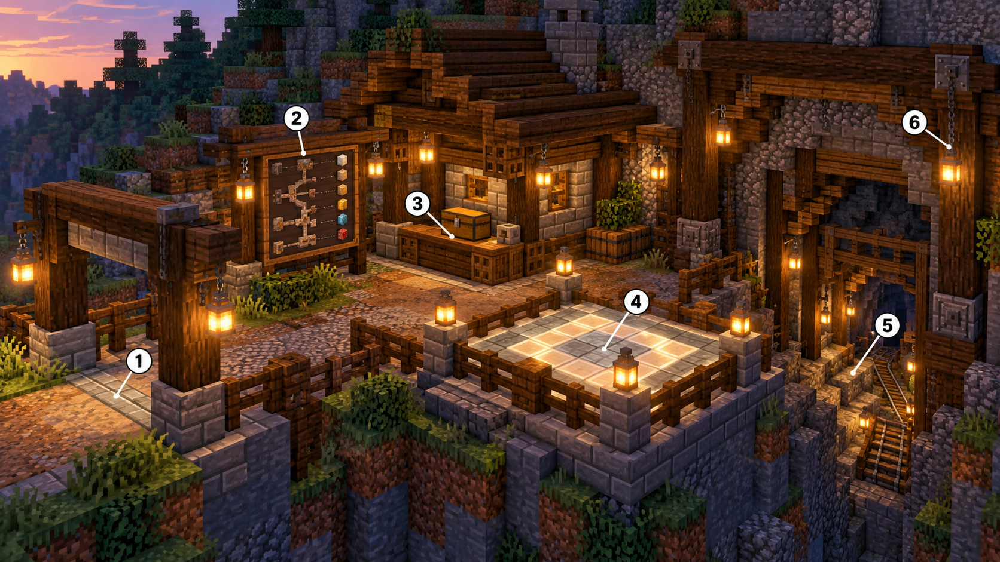
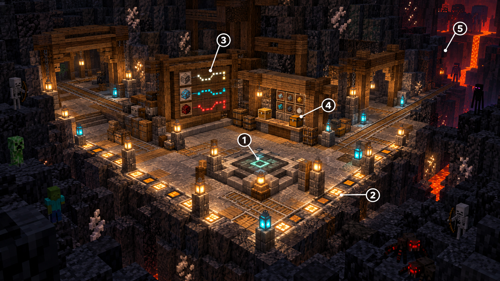

# Public Mines concept art: builder notes

These AI-generated boards communicate the intended functions, mood, and circulation. Treat them as visual references, not exact block plans or final dimensions. Build with ordinary pack-available blocks and adapt palettes to the generated route. Safe-zone boundaries are server-registered gameplay volumes; the floor lights and markers below communicate their extent to players and do not create a forcefield.

## Surface entrance hub

1. **Arrival and return threshold.** Make the entry unmistakable from the approach. Keep the return/teleport pad unobstructed and give players room to arrive without being pushed into the mine route.
2. **Route and depth board.** Orient players before they descend. Reserve a clear wall/board surface for the current run, checkpoint/depth information, and the route ahead.
3. **Foreman's Dispatch counter.** Present a private deposit/retrieve interaction as a sturdy work counter and secure locker. The art is only a visual shell; storage remains per-player and persistent according to the spec.
4. **Safe arrival pad.** Keep the surface entry/return area inside an explicit safe-zone volume. Use consistent paving and lanterns as visible boundary cues; leave the pad clear for teleport arrivals.
5. **Mine descent.** Give the first route a strong visual pull and readable stair/rail/track direction. The hub is the entrance, not a replacement for the continuous generated mineshaft.
6. **Frame and lighting.** Use repeated timber supports, stone footings, iron details, and lanterns to define the threshold and keep circulation legible. Keep decoration out of the walking and teleport footprint.

## Deep checkpoint safe zone

1. **Checkpoint/return pad.** Place it on a level, hazard-free platform with a clear arrival area and obvious connections back to the explored mine.
2. **Visible safe-zone edge.** Use a continuous, readable floor inlay with lantern posts or equivalent palette changes. Keep the passage open: protection comes from the server-side registered volume and combat rules, not a physical barrier. Hostile mobs stay outside; normal PvE resumes beyond the marked edge.
3. **Depth and route board.** Indicate current depth/run state and nearby route choices so players can decide whether to bank or push farther.
4. **Foreman's Dispatch access.** Provide the matching private deposit/retrieve station. Keep interaction access inside the safe-zone bounds and maintain a clear approach.
5. **Danger beyond the station.** Show the route continuing into darker, riskier Chaos-depth terrain, with ore and hazards such as quartz and lava outside the safe zone. Mobs and combat belong in those outer routes, never inside the marked sanctuary.

## Builder constraints

- Use compact, repeatable station footprints that can fit algorithmically generated caverns; do not require a prefab mansion or fixed world structure.
- Register exact bounded safe-zone volumes against each active run for the surface hub, checkpoint pad, and Dispatch interaction area. Remove stale registrations when a run resets or a station is removed.
- The marked safe zone must remain hostile-mob-free. Block combat damage/effects across its boundary, deny player attacks from inside, and restore ordinary PvE outside it. Mine-wide PvP remains disabled.
- Keep teleport pads clear, level, and safe from liquids, hazards, and intersecting collisions.
- Match materials to the local biome/depth palette while preserving visual consistency for the hub's orientation, storage, and safe-zone markers.
